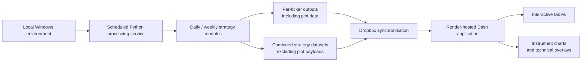

# Trading Dash — Quantitative Market Analysis Platform

[](https://trading-uptrend-tec.onrender.com/)
[](https://www.python.org/)

A Python-based quantitative market-analysis platform that processes a broad universe of financial instruments through four daily and weekly strategy categories, stores structured analytical outputs, and presents the results through an interactive Dash/Plotly web application.

**Live dashboard:** https://trading-uptrend-tec.onrender.com/

> **Project status:** This repository documents a personal quantitative research and analytics platform. The dashboard and data-processing workflow are implemented, but this documentation does not claim independently validated investment performance, production-grade availability, or suitability for investment decisions. Strategy results are analytical outputs, not guarantees of future outcomes.

## Project at a glance

The platform separates strategy computation from interactive visualisation:

- A local Windows Python service runs the strategy calculations on a schedule.
- Strategy modules process a large configured universe of tickers.
- Results are serialised as per-instrument and consolidated pickle datasets.
- Dropbox synchronises the generated datasets between the local processing environment and the dashboard environment.
- A Dash/Plotly application hosted on Render provides interactive tables and instrument-level charts.

This separation allows the dashboard to inspect precomputed results without rerunning the full strategy calculations for each user interaction.

## Strategy categories

The processing service runs four independent strategy categories:

| Category | Frequency | Framework |
|---|---|---|
| Daily Swing Trading | Daily | CCI, MA20, MA40 and price/trend conditions |
| Weekly Swing Trading | Weekly | CCI, MA20, MA40 and price/trend conditions |
| Daily Positioning | Daily | Timeframe-specific positioning analysis |
| Weekly Positioning | Weekly | Timeframe-specific positioning analysis |

The swing-trading framework includes technical conditions, entry/exit signals, dynamic stop-loss calculations, trailing stop mechanisms, and earnings-related warnings. The positioning strategies generate separate daily and weekly analytical outputs.

Detailed strategy-definition modules are imported by the local processing service and are not listed among the files in this public dashboard repository. This repository therefore describes the strategy families and data interfaces, not the complete internal implementation of every strategy.

## System architecture



See [`diagrams/architecture_diagram.mmd`](diagrams/architecture_diagram.mmd) and [`docs/system_architecture.md`](docs/system_architecture.md).

## Data-processing workflow

The local service performs the following steps:

1. Iterates over a configured ticker universe.
2. Calls each of the four strategy-definition functions for each ticker.
3. Saves an instrument-level pickle containing `Ticker` and `plot_dict` when those fields are available.
4. Removes the plot payload from the result used for aggregation.
5. Concatenates results into one combined dataset per strategy category.
6. Runs garbage collection after processing.
7. Transfers generated per-ticker folders and combined pickle files to Dropbox.
8. Logs task duration and transfer outcomes.

The supplied service code uses separate outputs for plotting payloads and consolidated tabular/analytical records. This avoids repeating large chart payloads in the combined datasets.

## Dropbox synchronisation

The Windows service uses a staged file-copy approach for the per-ticker folders: it copies to a temporary destination, replaces the destination file, removes stale destination files, waits for the destination folder's file snapshot to remain stable, and then removes the local source folder.

Combined strategy pickle files are copied through a temporary file and atomically replaced at the destination before the local source is removed.

The implementation includes logging, exception handling, and a bounded wait for folder stability. These mechanisms reduce the chance of the dashboard encountering files while they are actively being copied; they do not guarantee that every cloud-sync or network failure scenario is recoverable.

## Dashboard

The public README describes a web interface that supports:

- Selecting daily or weekly strategy datasets.
- Switching between swing-trading and positioning categories.
- Loading processed results into interactive tables.
- Sorting and inspecting analytical records.
- Selecting an instrument for detailed chart analysis.
- Viewing historical price action and candlesticks.
- Displaying technical indicators, moving averages, signal markers, and dynamic stop-loss levels.
- Reviewing precomputed results without rerunning the complete strategy pipeline.

The application uses Python, Dash, Plotly, Plotly Graph Objects, and Dash Bootstrap Components.

## Technology stack

| Area | Technologies |
|---|---|
| Language and data processing | Python, pandas, NumPy |
| Market data | yfinance and historical market-data processing |
| Technical analysis | CCI, moving averages, trend and signal calculations |
| Dashboard | Dash, Plotly, Plotly Graph Objects, Dash Bootstrap Components |
| Automation | Windows background service, Python `schedule`, logging |
| Data serialisation | pandas pickle / Python pickle |
| Cloud synchronisation | Dropbox |
| Source control and hosting | GitHub, Render |
| Development | JupyterLab and Python development environment |

## Repository contents

The public repository currently contains the dashboard application and deployment-related files:

```text
Trading_Dash_APP/
├── .gitignore
├── Procfile
├── README.md
├── dropbox_utils.py
├── render.yaml
├── requirements.txt
├── runtime.txt
└── trading_data_plot.py
```

The local processing service described in the accompanying architecture documentation is separate from this dashboard repository. Its service script imports four strategy-definition modules and produces the pickle datasets consumed by the dashboard.

## Engineering considerations

The project addresses practical problems in multi-instrument quantitative data processing and web analytics, including incomplete market-data responses, large batch workloads, persistence of chart-ready datasets, background-service logging, cloud file synchronisation, and dashboard handling of missing or malformed inputs.

The service implementation also has areas that merit further hardening, documented in [`docs/development_roadmap.md`](docs/development_roadmap.md). Examples include making scheduling and time-zone behaviour explicit, improving recovery for interrupted transfers, validating dataset schemas, and strengthening operational monitoring.

## Documentation

- [Automation and Deployment](docs/automation_and_deployment.md)
- [Dashboard Visualisation](docs/dashboard_visualisation.md)
- [Data Pipeline](docs/data_pipeline.md)
- [Quantitative Strategies](docs/quantitative_strategies.md)
- [System Architecture](docs/system_architecture.md)
- [Development roadmap](docs/development_roadmap.md)
- [Licence considerations](LICENSE_CHOICE.md)

## Scope and limitations

- The dashboard presents outputs generated by the separate processing service; it does not itself establish that strategy calculations are correct or profitable.
- Strategy-definition source files are not part of the public repository file list reviewed for this documentation.
- Pickle files are Python-specific serialised objects and should only be loaded from trusted sources.
- Dropbox synchronisation and Render hosting introduce external availability and credential-management dependencies.
- No claim is made that the system is an investment service, a broker-connected execution platform, or a validated investment strategy.

## Disclaimer

This project is provided for software engineering, quantitative research, and educational demonstration. It is not investment advice, a recommendation, or an offer to buy or sell financial instruments. Trading and investing involve risk, and historical or generated strategy signals do not guarantee future results.
