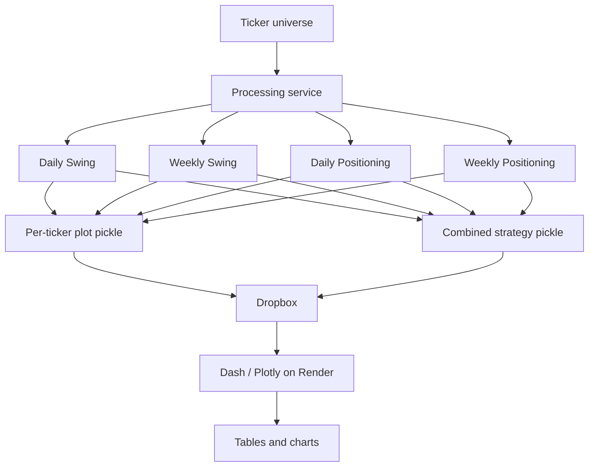

# System Architecture

## 1. Design overview

The platform separates the computational workload from the user-facing analytical application.

**Local computation:** a Windows Python service invokes four strategy-definition functions across a configured ticker universe and creates serialised outputs.

**Cloud data handoff:** generated files are transferred to Dropbox, which acts as the synchronisation layer between the local processing environment and the hosted dashboard.

**Web presentation:** a Dash/Plotly application deployed on Render reads the prepared datasets and exposes tables and instrument-level visualisations.

This arrangement means that a dashboard interaction can inspect precomputed results rather than launch the full multi-ticker strategy workload.

## 2. Main components

### Windows processing service
The supplied service script:
- Configures a file-based logger.
- Defines local output and Dropbox paths.
- Creates per-strategy output folders.
- Iterates through the configured ticker list.
- Calls four strategy-definition functions for each ticker.
- Handles each strategy call in its own exception block so one failed strategy/ticker does not stop the remaining calls.
- Builds combined datasets, invokes garbage collection, and synchronises outputs.

### Strategy-definition modules
Four imported functions represent the strategy categories:
- Daily Swing Trading — CCI / MA20 / MA40, daily interval
- Weekly Swing Trading — CCI / MA20 / MA40, weekly interval
- Daily Positioning — daily interval
- Weekly Positioning — weekly interval

The strategy-definition files are imported by the local service. They are not shown in the public dashboard repository file listing reviewed for this documentation. Internal calculations are therefore not reconstructed or inferred here.

### Output serialisation
For each strategy and ticker, the service saves an instrument-level pickle containing `Ticker` and `plot_dict` fields if both are present. It also appends a copy of the strategy result with `plot_dict` removed to a list used to create a combined strategy pickle.

### Dropbox synchronisation
The service copies generated instrument folders and combined files to Dropbox. The per-ticker folder flow uses temporary destination files, replacement, stale-file cleanup, and a folder-stability check. Combined files are copied to a temporary file and replaced at the destination before the local source is removed.

### Dash application
The GitHub repository includes `trading_data_plot.py`, `dropbox_utils.py`, dependency and Render configuration files. The README describes daily/weekly and swing/positioning selectors, interactive result tables, and instrument-level charts.

## 3. Data flow

## 4. Deployment boundary

The architecture described in the supplied document places strategy computation on a local Windows environment and the dashboard on Render. Dropbox provides the shared data layer. GitHub contains the dashboard application and deployment configuration, not necessarily every component used by the local processing service.

## 5. Configuration and operational dependencies

The service depends on:
- A Windows machine and its Python environment
- Strategy-definition modules available to the service
- Market-data access used by those modules
- Local output directories
- A configured Dropbox client and synchronised folder
- The Render-hosted dashboard and its runtime configuration

Credentials, personal directory paths, and account-specific configuration should remain outside public source control.

## 6. Architecture boundaries

This is a quantitative analysis and visualisation pipeline. The supplied service code does not describe broker order routing or automatic trade execution. Strategy calculations produce analytical datasets and signals; the dashboard presents those outputs.
